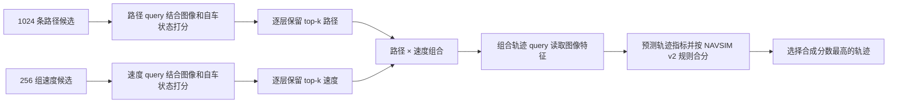

# 01：路径和速度怎样组成并选出一条轨迹

这份笔记只讲 SparseDriveV2 当前 NAVSIM 实现里的候选轨迹选择。先记住一句话：**路径决定往哪走，速度决定沿这条路什么时候走到哪里。**模型先分别筛路径和速度，再细看两者组合出的少量轨迹。

## 先看全流程



这几个分数不要混为一谈：

| 名称 | 对象 | 作用 |
|---|---|---|
| `path_scores` | 路径候选 | 路径分支排序和逐层筛选 |
| `vel_scores` | 速度候选 | 速度分支排序和逐层筛选 |
| `traj_scores` | 组合轨迹 | 训练时的轨迹模仿损失；当前推理最终选择不按它排序 |
| 指标合成 `scores` | 组合轨迹 | 推理时按预测指标合分，选最终输出 |

## 1. 路径词表和速度词表是什么

默认配置有两套固定候选：

- **1024 条路径**：每条有 50 个 `(x, y, yaw)` 采样点，名义间隔为 1 米。
- **256 组速度序列**：每组有 8 个标量速度值，每个值对应半秒，覆盖 4 秒。

路径是空间形状，速度没有方向。相同的速度序列可以沿不同路径行驶，得到不同轨迹；相同的路径也可以搭配不同速度，得到不同到达位置和时序。

从形状上看：

```text
path vocabulary:       [1024, 50, 3]  # 1024 条 × 50 点 × (x,y,yaw)
velocity vocabulary:   [256, 8]       # 256 组 × 8 个速度
trajectory vocabulary:[1024, 256, 8, 3]
trajectory mask:       [1024, 256, 8]
```

路径和速度全部组合有 `1024 × 256 = 262,144` 种。聚类脚本把组合后的轨迹预先写入 `trajectory_1024_256.npz`，模型加载后固定使用这些词表，不在训练中更新它们。

## 2. 具体算一遍：速度怎样沿路径变成轨迹

假设速度候选是：

```text
速度 (m/s)：       [2, 2, 3, 4, 5, 5, 4, 3]
每半秒走的距离：   [1, 1, 1.5, 2, 2.5, 2.5, 2, 1.5] 米
累计距离 (m)：     [1, 2, 3.5, 5.5, 8, 10.5, 12.5, 14]
```

例如第三步速度是 `3 m/s`，半秒内走 `3 × 0.5 = 1.5 m`；加上前两步已经走的 2 米，第三个轨迹点位于路径的 3.5 米处。

假设一条路径从原点出发，先向前，再向左转。为方便手算，用每米一个点表示：

| 沿路径距离 | `(x, y)` | `yaw`（示意） |
|---:|---:|---:|
| 0 m | `(0, 0)` | 0 |
| 1 m | `(1, 0)` | 0 |
| 2 m | `(2, 0)` | 0 |
| 3 m | `(3, 0)` | 0 |
| 4 m | `(3, 1)` | π/4 |
| 5 m | `(3, 2)` | π/2 |
| 6 m | `(3, 3)` | π/2 |

那么：

- 累计距离 `1 m` 对应 `(1, 0, 0)`。
- 累计距离 `3.5 m` 落在 3 m 和 4 m 之间，按一半比例插值得到约 `(3, 0.5, π/8)`。
- 累计距离 `5.5 m` 落在 5 m 和 6 m 之间，得到约 `(3, 2.5, π/2)`。

8 个累计距离都这样查路径，就得到 8 个 `(x,y,yaw)`，也就是这条路径和这组速度对应的一条 4 秒轨迹。换一条路径、速度保持不变，8 个目标距离仍相同，但查到的空间坐标会不同。

源码先对速度乘 `DT=0.5` 并累计；再计算路径点之间的平面距离，形成沿路径的累计弧长；最后分别对 `x`、`y`、`yaw` 插值。见 `scripts/cluster/cluster_anchor.py::interp_trajectory`。

### mask 表示什么

假设路径总长只有 10 米，而某组速度的 8 个累计距离是 `[1, 2, 3.5, 5.5, 8, 10.5, 12.5, 14]` 米，那么：

```text
trajectory_mask = [1, 1, 1, 1, 1, 0, 0, 0]
```

`1` 表示目标距离仍在路径长度内，`0` 表示已经超过路径末端。代码虽然会为越界距离外推一个坐标，但 mask 会把它标为无效。**这个 mask 只表示路径长度是否够，不表示无碰撞、可行驶区域合规或安全。**

## 3. 为什么不能一次把 262,144 条都精算

模型用两层 decoder 逐步剪枝。每一层都分别给路径和速度打分并保留 top-k：

| 阶段 | 路径数 | 速度数 | 组合数 |
|---|---:|---:|---:|
| 初始候选 | 1024 | 256 | 262,144 |
| 第 0 层后 | 128 | 64 | 8,192 |
| 第 1 层后 | 20 | 10 | 200 |

```text
路径：1024 ──top-128──> 128 ──top-20──> 20 ─┐
                                             ├─ 20 × 10 = 最多 200 条完整轨迹
速度： 256 ──top-64───>  64 ──top-10──> 10 ─┘
```

路径分支把路径点投影到相机特征上，聚合这些位置的图像信息；速度分支通过 attention 读取图像特征。两支都结合自车状态，分别由 MLP 产生 `path_scores` 和 `vel_scores`。分数只用于排序筛选：高分不等于已验证安全。

最后一层将保留路径和速度的 embedding 组合起来，对最多 200 条完整轨迹再聚合图像特征，得到轨迹 embedding。然后从同一个 embedding 预测 `traj_scores` 和各项驾驶指标。

## 4. 训练时分数怎么学：用 GT 距离做软目标

训练时，代码会计算候选与真实驾驶轨迹（GT）的距离。越接近 GT，目标权重通常越高；目标不是简单地只给最近的一条候选 1、其他候选全给 0。

以路径分支为例，假设三条候选的平均平方位置误差是 `0、0.01、0.02 m²`。默认距离缩放系数是 `path_sigmas × len_path = 4 × 50 = 200`，于是软目标约为：

```text
softmax(-[0, 0.01, 0.02] × 200)
= softmax([0, -2, -4])
≈ [0.867, 0.117, 0.016]
```

这表示第一条最接近 GT，训练时应最受偏好；第二、三条仍有较小权重。真实样本会对整套路径候选计算，数字例子只展示公式的含义。`path_scores` 作为 logits 与这个软目标做交叉熵，推动预测排序接近目标分布。

其他损失的监督对象不同：

| 损失 | 比较对象 | 直观含义 |
|---|---|---|
| `path_loss` | 各路径与 GT path | 哪些路径形状接近示范 |
| `velocity_loss` | 各速度模板与 GT 速度序列 | 哪些速度变化接近示范 |
| `traj_loss` | 最后保留的组合轨迹与 GT trajectory | 哪些完整轨迹接近示范 |
| 各 `metric_loss` | 指标头预测与 PDM metric cache 标签 | 预测候选的碰撞、合规、进度等指标 |

前三种是模仿目标的距离监督；指标损失监督预测的驾驶指标。它们互有关联，但不是同一个损失。

## 5. 推理时最后怎么选

推理时没有 GT 距离可用。路径和速度分数先完成 top-k 筛选，得到最多 200 条轨迹；模型再对每条轨迹预测指标。NAVSIM v2 实现将相关 metric logits 经过 sigmoid 后按规则合成总分：

```text
硬约束因子：
无责碰撞 × 可行驶区域合规 × 行驶方向合规 × 红绿灯合规

加权项：
5 × 碰撞时间 + 5 × 自车进度 + 2 × 车道保持 + 2 × 历史舒适度

总分 = 硬约束因子 × 加权项
```

对最多 200 个总分取 `argmax`，对应的 8 个 pose 就是最终输出。比如，一条轨迹即使进度预测高，只要某个硬约束指标很低，乘积也会压低它的总分。

这是**模型预测指标后用于候选选择**。NAVSIM 评测器在最终轨迹输出后，按基准流程计算实际评测结果；模型推理时并不知道候选真实的评测结果。

## 6. 本节对应源码

- 词表规模、间隔、筛选数量和软标签系数：`navsim/agents/sparsedrive/sparsedrive_config.py`
- 组合路径与速度、插值得到轨迹及 mask：`scripts/cluster/cluster_anchor.py::interp_trajectory`
- 词表载入：`navsim/agents/sparsedrive/sparsedrive_model.py::TrajectoryHead`
- 路径/速度打分、top-k、损失、指标合分和输出：`navsim/agents/sparsedrive/custom_decoder.py::CustomTransformerDecoderLayer.forward`
- 路径点的相机投影与图像特征采样由 `DeformableFeatureAggregation` 完成，源码见 `navsim/agents/sparsedrive/blocks.py`。
