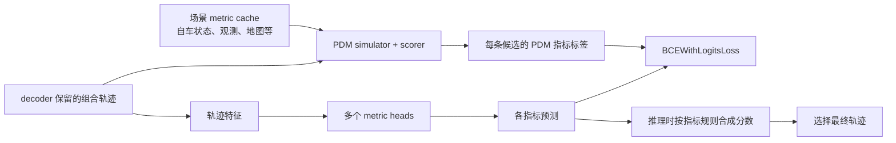

# 02：指标预测头与 PDM 怎样评估候选轨迹

本节沿用前一节的候选轨迹流程，专门回答三个问题：PDM 在训练里做什么、各项指标分别检查什么、模型推理时怎样用预测指标选轨迹。内容以当前仓库的 NAVSIM v2 实现为准。

## 先分清三种角色

| 角色 | 做什么 | 发生阶段 |
|---|---|---|
| **PDM simulator/scorer** | 在场景上下文中模拟候选并计算指标，生成训练监督标签 | 训练时 |
| **SparseDrive metric heads** | 根据候选轨迹特征预测各项指标 | 训练和推理时 |
| **NAVSIM evaluator** | 对模型最终输出的轨迹执行基准评估 | 评测时 |

PDM 在这里是一套仓库内的规划模拟和评分实现，不是一个独立的神经网络库。场景 `metric_cache.pkl` 提供 ego state、环境观测、地图等上下文；它不是“每条候选轨迹的指标答案表”。训练时，代码把当前 decoder 保留的组合轨迹送进 PDM 仿真和评分，现场得到这些候选的监督值。



## 1. 训练时 PDM 标签怎样对应候选

最后一层 decoder 最多保留 `20 × 10 = 200` 条路径/速度组合。训练时，`get_pdm_score_v2` 对每个样本读取场景 metric cache，将缓存里的参考轨迹和这批候选轨迹送入 PDM simulator 与 scorer。返回指标数组时用 `[1:]` 去掉列表中的第一条参考轨迹，只保留模型候选对应的指标。

随后 decoder 对每个指标分别计算 `BCEWithLogitsLoss`。标签来自 PDM，预测来自 metric head；PDM 不是可微模块，梯度不会穿过仿真器，而是由损失反向更新网络。当前代码还会把标签中恰好等于 `0.5` 的值改成 `0` 后再计算损失。

## 2. NAVSIM v2 的八个监督指标

下面的数值描述 PDM scorer 为候选产生的标签。部分指标是严格的 0/1，部分指标可先产生 `0.5` 或连续值；指标头学习这些监督值。

### 四个合规类指标

| 指标 | PDM 检查逻辑 | 直观例子 |
|---|---|---|
| `no_at_fault_collisions` | 检查自车车身与场景对象是否相交，并按碰撞类型和责任规则判断。自车有责时分数降低；非 `AGENT_TYPES` 对象的特定碰撞会产生 `0.5`，进入 decoder loss 前会映射为 `0`。 | 撞上前方静止车辆会被判有责；并非任何接触都自动等于有责碰撞。 |
| `drivable_area_compliance` | 沿轨迹检查自车车身四个角；任一角在任一时刻落出可行驶区域，记 `0`，全程未越界记 `1`。 | 车中心还在车道内，但车身角压出路面，也会不合规。 |
| `driving_direction_compliance` | 根据自车中心是否在路线对应的车道/连接道路区域判断路线外行驶距离；路口中的距离不累计。默认滚动 1 秒窗口：小于 2 m 得 `1`，2 至小于 6 m 得 `0.5`，达到 6 m 得 `0`。 | 短暂进入对向车道和持续向前逆行会得到不同分数。 |
| `traffic_light_compliance` | 检查自车车身是否与 observation 中标记为红灯的对象相交；任一时刻相交即 `0`，否则 `1`。 | 车辆即使仍在可行驶区域内，与红灯对象相交仍会违反此项。 |

这些指标各自回答不同问题：是否有责碰撞、是否越界、是否驶入路线外的车道、是否闯红灯。它们不会彼此替代。

### 四个加权类指标

| 指标 | PDM 检查逻辑 | 直观例子 |
|---|---|---|
| `time_to_collision_within_bound` | 在轨迹采样时刻按当前状态向前投影自车，检查默认约 1 秒预测窗口内是否出现符合条件的近未来碰撞风险；检测到风险记 `0`，否则保持 `1`。这是近未来风险检查，不是再次完整模拟未来。 | 当前尚未接触前车，但向前投影后车身很快重叠，TTC 可记为 `0`。 |
| `ego_progress` | 将轨迹起点和终点投影到路线中心线，计算沿路线向前推进的距离，负进度截成 0。进入训练指标前还会在候选与参考轨迹上下文中归一化，并受合规项影响。 | 起点投影在路线 12 m、终点在 18 m，原始进度为 6 m；它不是车辆实际走过的总路程。 |
| `lane_keeping` | 自车中心到路线中心线横向距离超过默认 `0.5 m`，并在非路口处连续达到默认 `2 s`，记 `0`；否则为 `1`。 | 偏离 0.7 m 持续 1.5 秒后回正，不触发失败；持续 2 秒则记 0。 |
| `history_comfort` | 将真实历史状态与候选未来状态拼接，检查纵向/横向加速度、jerk、纵向 jerk、横摆角加速度和横摆角速度是否均在舒适范围；全部通过为 `1`，有一项超限为 `0`。没有可用历史轨迹时默认 `1`。 | 历史平稳行驶后，候选一开始突然急加速，拼接处可能触发舒适性失败。 |

PDM 的具体碰撞责任分类、车身区域、路线中心线、阈值和舒适性边界都按代码实现；上表是便于理解的概括。比如“无责碰撞”不等同于简单的几何碰撞检测，“行驶方向”也不是只看车辆 heading 与道路方向的夹角。

## 3. 推理时模型怎样合成指标分数

每个指标头输出 logit。推理选择时先对 logit 做 sigmoid，得到 0 到 1 之间的预测值，再按 NAVSIM v2 实现合成：

```text
合规乘积 =
  无责碰撞 × 可行驶区域合规 × 行驶方向合规 × 红绿灯合规

加权和 =
  5 × 碰撞时间 + 5 × 自车进度 + 2 × 车道保持 + 2 × 历史舒适度

预测合成分数 = 合规乘积 × 加权和
```

模型对最多 200 条候选的预测合成分数取 `argmax`，对应轨迹成为模型输出。例如某轨迹的进度预测很高，但红绿灯合规预测很低，合规乘积会把总分压下来；因此模型不是只按“走得最远”选轨迹。

这里的预测合成分数用于**模型内部候选选择**。NAVSIM evaluator 随后按基准流程评估最终输出轨迹。训练时的 PDM 监督、推理时 metric head 的预测、评测器对最终轨迹的实际评分，是三个相关但不同的环节。

## 4. 一个候选的训练与推理示意

假设一条候选绕开停着的车，沿路线行驶，未碰红灯对象，也没有明显舒适性问题：

1. **训练监督**：PDM 在对应场景中模拟它，分别给出碰撞、道路、方向、红灯、TTC、进度、车道保持和舒适度指标。
2. **模型学习**：metric heads 根据视觉和轨迹特征预测这些值；各预测与 PDM 标签计算 BCE loss。
3. **推理选择**：没有 PDM 标签可用，模型用预测值合成分数，与其他候选比较后选择一条。
4. **NAVSIM 评测**：对最终输出轨迹进行基准评估，产生报告中的实际结果。

如果安全候选在第一阶段 top-k 中已被剪掉，后续指标头也无法把它重新选回来。因此最终选择质量既依赖前面的路径/速度筛选，也依赖指标预测和合分。

## 5. 对应代码

- 指标名单和最终合分：`navsim/agents/sparsedrive/sparsedrive_config.py`、`navsim/agents/sparsedrive/custom_decoder.py`
- PDM 候选轨迹转换、模拟和指标提取：`navsim/agents/sparsedrive/scorer/pdm_score_v2.py`
- 每个样本加载 metric cache、并行计算 PDM 标签：`navsim/agents/sparsedrive/scorer/get_pdm_score_v2.py`
- 碰撞、道路、行驶方向、TTC、进度、红灯、车道保持等 scorer：`navsim/planning/simulation/planner/pdm_planner/scoring/pdm_scorer.py`
- 舒适性阈值检查：`navsim/planning/simulation/planner/pdm_planner/scoring/pdm_comfort_metrics.py`
