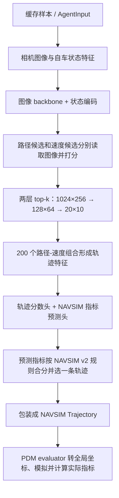

# 03：SparseDriveV2 推理链路

这份笔记把当前仓库的一次推理从输入一直串到 NAVSIM 评测。先记住整体顺序：



## 1. 推理输入：图像和自车状态

当前调试入口是 `scripts/debug/debug_inference.py`。它从缓存读取一个样本，由 `CacheOnlyDataset` 构造模型输入，再执行 `agent(features, None)`。第二个参数是 `targets`；推理时传 `None`，模型只生成预测，不计算依赖训练标签的损失。

输入字典的主要内容：

| 输入 | 当前仓库中的内容 | 后续用途 |
|---|---|---|
| `camera_feature` | 预处理后的图像、相机投影矩阵等 | backbone 提取多层图像特征；decoder 根据候选路径/轨迹位置读取图像特征 |
| `status_feature` | 4 维 `driving_command`、2 维 ego velocity、2 维 ego acceleration，合计 8 维 | 经 `Linear(8, 256)` 投影成 `status_encoding`，加入路径和速度候选特征 |

调试输入中可能保留多帧、多相机元数据，但 `SparseDriveFeatureBuilder.pipeline` 只取最后一帧；当前配置选择 `cam_l0`、`cam_f0`、`cam_r0` 三路图像。四维 `driving_command` 的语义没有在本仓库读取代码中展开，代码只是原样拼进状态特征。

图像经过 resize/crop、归一化和张量整理。相机内外参则用于生成 `projection_mat`，供后续把 3D 关键点投影到图像特征上。

## 2. Backbone 和状态编码

`SparseDriveModel.forward` 完成两件准备工作：

1. `_status_encoding` 把 8 维 `status_feature` 映射为 256 维状态向量。
2. `_backbone(imgs)` 从三路图像提取多层 feature maps，放入 `camera_feature["feature_maps"]`。

之后模型把图像特征、状态编码和 targets 交给 `TrajectoryHead`。推理时 targets 为 `None`；训练时 targets 才用于生成损失。

## 3. 路径和速度候选先分别打分

模型加载固定的 `path_vocab`、`vel_vocab` 和 `traj_vocab`：

```text
path_vocab:       [1024, 50, 3]       # 路径的 (x,y,yaw) 点
vel_vocab:        [256, 8]            # 速度序列
traj_vocab:       [1024, 256, 8, 3]   # 路径×速度的组合轨迹
trajectory_mask:  [1024, 256, 8]
```

`path_pos_embed`、`vel_pos_embed` 将路径和速度数值编码成 256 维 embedding，再加上 `status_encoding`。

- **路径分支**：`p_deform_model` 根据路径点生成 3D 采样关键点，投影到三路相机的多层特征图上，采样并聚合视觉信息；路径特征再经过候选间自注意力和 FFN，由 `path_mlp` 输出 `path_scores`。
- **速度分支**：`v_img_attention` 是普通 `nn.MultiheadAttention` cross-attention。速度 embedding 作 Query，最后一层图像特征展平后作 Key/Value；随后速度候选间做自注意力和 FFN，由 `vel_mlp` 输出 `vel_scores`。

两支分数分别筛路径、速度，不是对全部 262,144 条组合轨迹逐条做最终评分：

| 阶段 | 路径候选 | 速度候选 | 组合数 |
|---|---:|---:|---:|
| 初始 | 1024 | 256 | 262,144 |
| decoder 第 0 层筛选后 | 128 | 64 | 8,192 |
| decoder 第 1 层筛选后 | 20 | 10 | 200 |

每次筛选分别取 `path_scores`、`vel_scores` 的 top-k，再沿 `traj_vocab` 的路径维和速度维取对应轨迹。

## 4. 组合轨迹读取图像并形成轨迹特征

最后一层把每个路径 embedding 与每个速度 embedding 相加，作为路径-速度组合的初始特征。最终最多有 `20 × 10 = 200` 个组合，对应 `[B, 200, 256]` 特征。

对应的 `traj_vocab` 提供每条组合轨迹的 8 个 `(x,y)` 采样点，传给 `t_deform_model` 作为几何锚点。它据此再次从图像特征中采样，并把视觉信息融合进轨迹 embedding。之后 200 个轨迹候选之间做自注意力和 FFN。

这里要分清两种数据：

- `traj_vocab` 是每个候选的固定几何轨迹。
- 代码中名为 `traj_emed` 的张量是候选的 256 维模型特征，经过路径/速度特征组合和视觉更新得到。

## 5. 两类输出头与最终候选选择

同一个轨迹 embedding 送进两类预测头：

1. `traj_mlp` 输出 `traj_scores`。训练时它用候选轨迹到 GT 轨迹的距离软目标计算 `traj_loss`。
2. 多个 `metric_heads` 预测 NAVSIM 指标。训练时用 metric cache 中由 PDM 产生的指标标签计算 BCE 损失。

**当前仓库的推理选择逻辑**：对指标 logits 做 sigmoid，按 NAVSIM v2 规则合成 `scores`，再对最多 200 条候选取 `argmax`。`traj_scores` 用于训练时的轨迹模仿损失，不参与这段最终 `argmax`。

合成结构可简写为：

```text
预测合成分数 =
  (无责碰撞 × 可行驶区域合规 × 行驶方向合规 × 红绿灯合规)
  × (5×TTC + 5×ego_progress + 2×lane_keeping + 2×history_comfort)
```

模型返回 `output["trajectory"]`，形状为 `[B, 8, 3]`，每条轨迹有 8 个 `(x,y,yaw)` 未来位姿。

## 6. 从模型输出到 NAVSIM 评测

缓存预测流程在 `AgentLightningModule.predict_step` 中：

1. 调用 `agent.forward(features, None)`。
2. 读取 `predictions["trajectory"]`。
3. 用 `trajectory_sampling` 将每个样本包装成 `navsim.common.dataclasses.Trajectory`，并放入以场景 token 为键的结果字典。

当前配置的采样为 4 秒、每 0.5 秒一个点，因此是 8 个未来 pose。之后 PDM evaluator 读取预测结果和对应 metric cache：`pdm_score_v2.transform_trajectory` 将自车坐标系 pose 转到全局坐标系、构造带时间信息的 `InterpolatedTrajectory`，再交给 PDM simulator/scorer，计算基准评测指标。

要区分两种“指标分”：模型推理时的**预测指标合成分**用于从候选中选一条；PDM evaluator 后续计算的**实际评测分**用于报告 NAVSIM 结果。

### 源码接口提醒

当前 `SparseDriveAgent.forward(features, targets)` 要求传入 `targets` 参数；缓存预测入口显式传 `None`。而 `AbstractAgent.compute_trajectory` 的通用实现调用 `self.forward(features)`，与这个 override 的参数签名不一致。若从 `compute_trajectory` 直接调用 SparseDriveAgent，需先核实所用分支是否提供了兼容实现；本仓库的缓存预测入口走的是 `AgentLightningModule.predict_step`。

## 7. 单样本调试与可视化

`scripts/debug/debug_inference.py` 在模型调用处适合设断点，按顺序查看：

```text
features
  → SparseDriveModel.forward 的 status_encoding / feature_maps
  → TrajectoryHead 的 path_vocab / vel_vocab / traj_vocab
  → CustomTransformerDecoderLayer 的 path_scores / vel_scores
  → 最后层的 traj_emed / metric_logit / scores
  → predictions["trajectory"]
```

脚本还会保存预测与 GT 的俯视轨迹图到 `exp/debug_inference/plots/<token>_trajectory.png`：红线是模型预测，绿线是 GT 4 秒轨迹，灰色虚线是 GT 路径。横轴为左右方向 `y`，纵轴为前进方向 `x`。这张图比较轨迹形状，不包含地图、障碍物和相机画面。

## 8. 相关源码

- 输入构造和图像处理：`navsim/agents/sparsedrive/sparsedrive_features.py`
- Backbone、状态编码和模型输出：`navsim/agents/sparsedrive/sparsedrive_model.py`
- 候选打分、筛选、轨迹/指标头和选择：`navsim/agents/sparsedrive/custom_decoder.py`
- deformable 图像特征聚合和关键点投影：`navsim/agents/sparsedrive/blocks.py`
- 缓存推理并包装 `Trajectory`：`navsim/planning/training/agent_lightning_module.py::predict_step`
- PDM 实际评测：`navsim/agents/sparsedrive/scorer/pdm_score_v2.py`
- 单样本调试与预测图：`scripts/debug/debug_inference.py`
